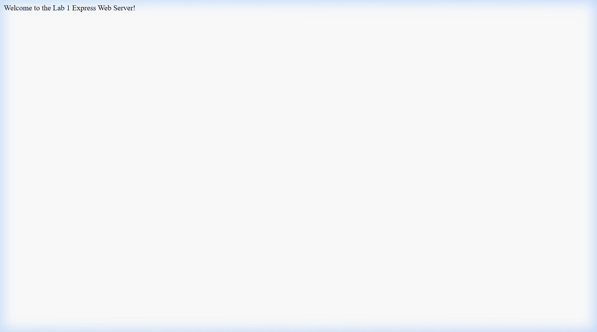
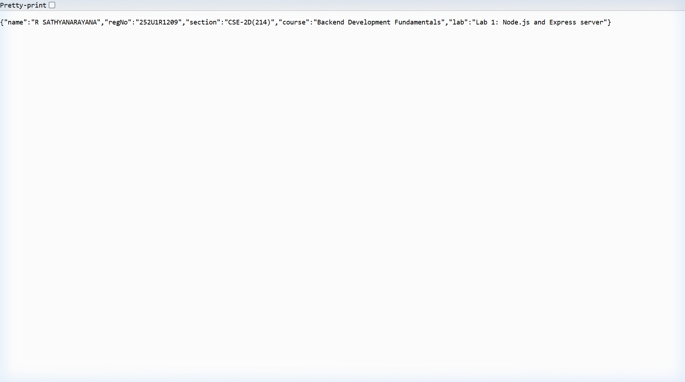
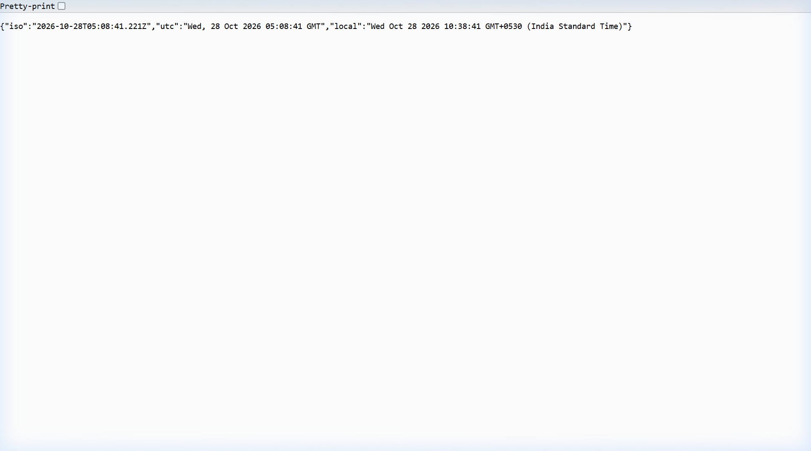
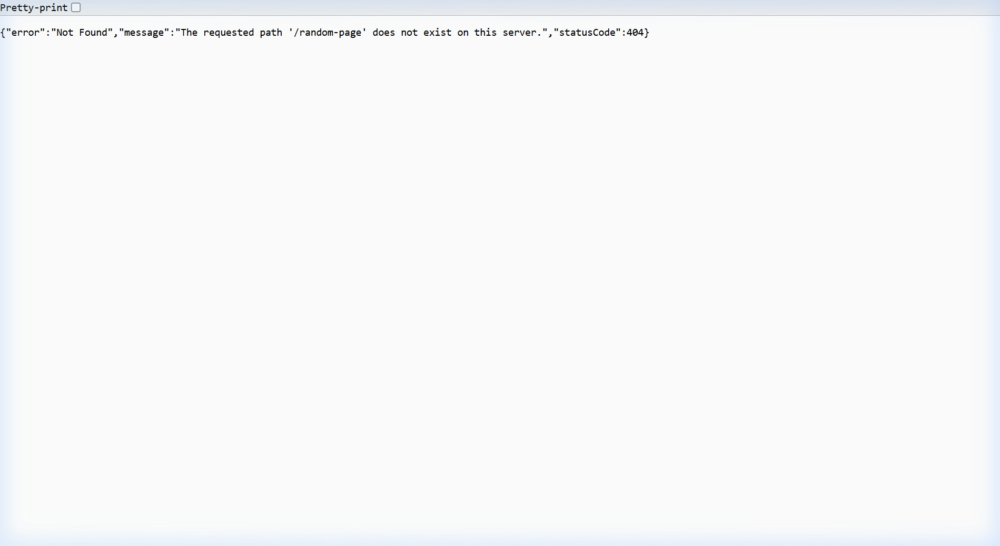

# Lab 1: Node.js and Express server

**Student Name:** R SATHYANARAYANA · **Registration Number:** 252U1R1209 · **Section:** CSE-2D(214)  
**Course:** Backend Development Fundamentals (Year II Term II) · **Faculty:** Joel Prashanth D · **Institution:** Aurora  
**Live Link:** [https://backend-dev-fundamentals.vercel.app](https://backend-dev-fundamentals.vercel.app)

---

## 📖 Table of Contents
1. [Objective](#objective)
2. [Explanation of package.json Fields](#explanation-of-packagejson-fields)
3. [How to Run](#how-to-run)
4. [Endpoints and Scripts](#endpoints-and-scripts)
5. [Screenshots of Working Endpoints](#screenshots-of-working-endpoints)
6. [Viva Questions & Answers](#viva-questions--answers)
7. [Notes: Problems Faced & Solutions](#notes-problems-faced--solutions)

---

## 🎯 Objective
Set up a Node.js project and build a modular web server, first using Node's built-in `http` module and then rewritten using the `Express` framework with routing, status code handling, and 404 fallback handling.

---

## 📦 Explanation of `package.json` Fields
When initializing a Node.js project with `npm init -y`, `package.json` is generated as the project manifest. Below is an explanation of every field:

| Field | Purpose / Description |
| :--- | :--- |
| `"name"` | The lowercase, URL-friendly unique identifier/name for this Node.js package or project (e.g., `"lab-1"`). |
| `"version"` | Follows Semantic Versioning (`MAJOR.MINOR.PATCH`, e.g., `"1.0.0"`). Tracks release iterations. |
| `"description"` | A brief human-readable summary of the package/project purpose. |
| `"main"` | The primary entry point file of the application that gets executed when the package is required or imported (e.g., `"index.js"`). |
| `"scripts"` | Custom terminal alias scripts that can be invoked via `npm run <script-name>` or `npm start` (e.g., `"start": "node index.js"`). |
| `"keywords"` | An array of search keywords to help discover the package in the npm registry. |
| `"author"` | Name, email, or URL of the package author/maintainer. |
| `"license"` | The legal software distribution license (e.g., `"ISC"`, `"MIT"`). |
| `"type"` | Specifies the module system: `"commonjs"` (uses `require` / `module.exports`) or `"module"` (ESM syntax using `import` / `export`). |
| `"dependencies"` | Production packages and libraries required at runtime (e.g., `"express": "^5.3.0"`). Installed into `node_modules`. |

---

## 🚀 How to Run

### 1. Prerequisites
- **Node.js** (v18.x or later installed)
- **npm** (v9.x or later installed)

### 2. Installation
Clone the repository and install dependencies:
```bash
# Clone the repository
git clone <your-repository-url>

# Navigate to the lab folder
cd lab-01

# Install required dependencies (Express)
npm install
```

### 3. Environment Variables
Create a `.env` file in the root of `lab-01/` (optional, default fallbacks are provided in code):
```env
PORT=3000
STUDENT_NAME=Your Full Name
STUDENT_REG_NO=Your Registration Number
STUDENT_SECTION=Your Section
```

### 4. Running the Servers
- **Run the Plain HTTP Server (Task 3):**
  ```bash
  npm run start:http
  # Runs http-server.js on http://localhost:3000
  ```

- **Run the Express Server (Tasks 4–7):**
  ```bash
  npm start
  # Runs index.js on http://localhost:3000
  ```

---

## 🌐 Endpoints and Scripts

### Available NPM Scripts
| Script Command | Description |
| :--- | :--- |
| `npm start` | Runs the Express application server (`node index.js`). |
| `npm run start:http` | Runs the plain Node.js built-in HTTP server (`node http-server.js`). |

### API Endpoints
| HTTP Method | Route Path | Description | Expected Status Code |
| :--- | :--- | :--- | :--- |
| `GET` | `/` | Welcome text message confirming the server is alive. | `200 OK` |
| `GET` | `/about` | Returns student information (Name, Reg No, Section, Course) in JSON format. | `200 OK` |
| `GET` | `/date` | Returns today's date formatted string (`Today's date is ${date}`) as taught in NxtWave. | `200 OK` |
| `GET` | `/time` | Returns the current server timestamp (ISO, UTC, and Local format) using `new Date()`. | `200 OK` |
| `*` | Any undefined path (e.g., `/random`) | Custom 404 JSON response for unhandled routes. | `404 Not Found` |

---

## 📸 Screenshots of Working Endpoints

### 1. Plain HTTP Server (`http.createServer`) - Replying "Hello SNR"


### 2. Express Server: GET `/` (Welcome Text)


### 3. Express Server: GET `/about` (JSON Student Details)


### 4. Express Server: GET `/date` (Getting Today's Date)


### 5. Express Server: GET `/time` (Current Date and Time)


### 6. Express Server: GET `/unknown-path` (404 Not Found Handling)


---

## 💬 Viva Questions & Answers

### 1. What is the difference between `package.json` and `node_modules`?
- **`package.json`**: It is a lightweight metadata file and project manifest. It contains project configuration, author information, scripts, and the exact names and semver versions of external dependencies needed by the project. It is checked into Git version control.
- **`node_modules`**: It is the physical directory on disk containing the actual downloaded source code and binaries of all dependencies and their recursive sub-dependencies. Because it can be hundreds of megabytes in size, it is added to `.gitignore` and **never committed to version control**. Anyone can reconstruct `node_modules` by running `npm install` from `package.json`.

### 2. What does `app.listen()` do?
- In Express, `app.listen(port, [callback])` binds and listens for incoming HTTP connections on the specified network port (e.g., 3000).
- Behind the scenes, Express invokes Node's built-in `http.createServer(this).listen(...)`, starting an asynchronous event loop that waits for incoming client socket requests and dispatches them to matching route handlers and middleware.

### 3. What do `request` (`req`) and `response` (`res`) represent?
- **`request` (`req`)**: An object representing the incoming HTTP request sent by the client (browser/Postman). It contains information such as HTTP method (`req.method`), URL path (`req.url`), route parameters (`req.params`), query parameters (`req.query`), headers (`req.headers`), and request body (`req.body`).
- **`response` (`res`)**: An object representing the outgoing HTTP response that the server sends back to the client. It provides methods to set status codes (`res.status()`), set HTTP headers (`res.set()`), and transmit data back via `res.send()`, `res.json()`, or `res.end()`.

---

## 🛠️ Notes: Problems Faced & Solutions
1. **Port Conflicts (`EADDRINUSE`)**:
   - *Problem:* Running both `http-server.js` and `index.js` simultaneously on port `3000` causes an `EADDRINUSE` error.
   - *Solution:* Used environment variable `PORT = process.env.PORT || 3000` allowing dynamic port assignment, and stopped the plain HTTP server process before starting the Express server.
2. **Preventing `node_modules` from Git Commits**:
   - *Problem:* `node_modules` contains thousands of files and should not be uploaded to GitHub.
   - *Solution:* Configured a `.gitignore` file with `node_modules/` and `.env` before initializing git commits.
3. **Handling Undefined Routes (404)**:
   - *Problem:* Express by default sends an HTML 404 page for unmatched routes.
   - *Solution:* Placed a catch-all middleware (`app.use((req, res) => ... )`) at the very end of the route definitions to return a structured JSON 404 response.
